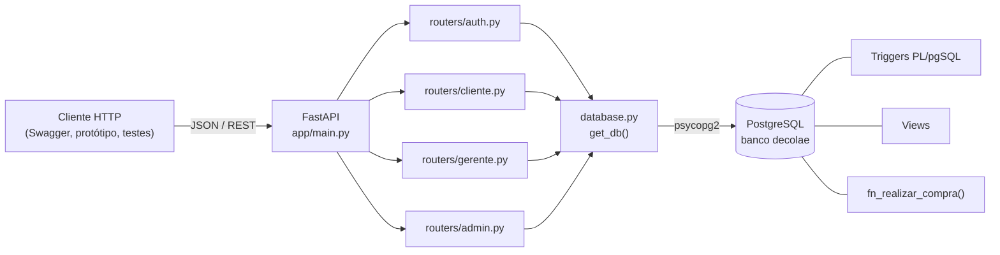
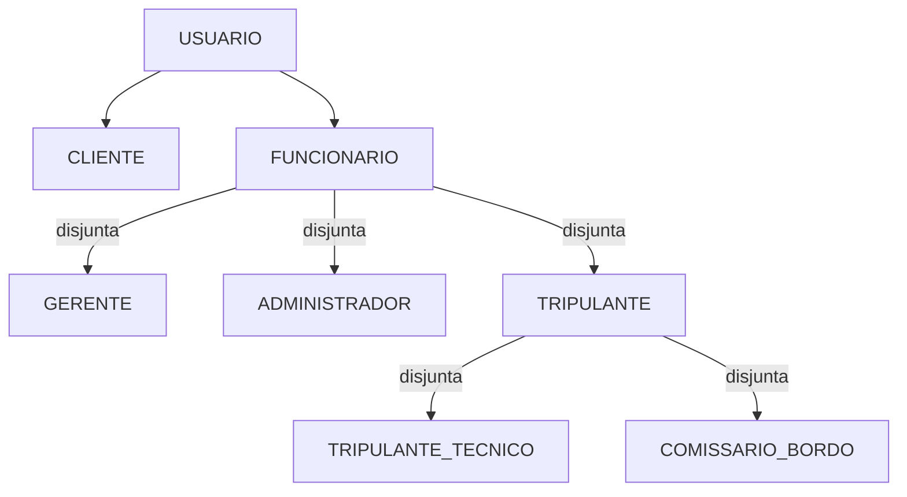
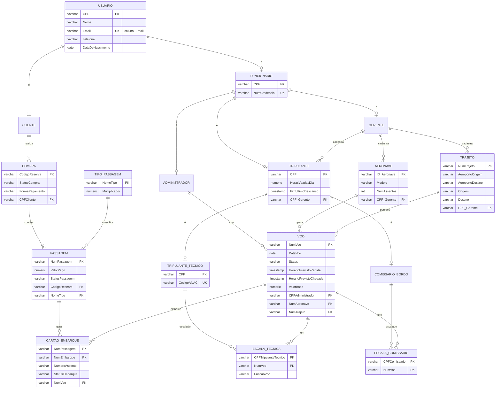
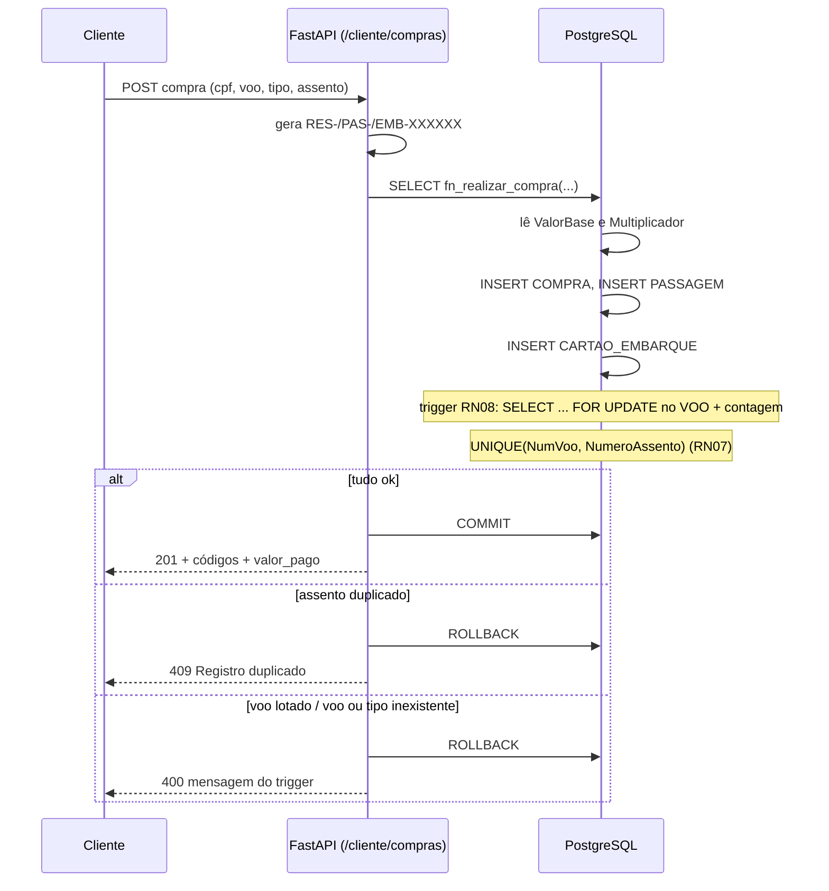
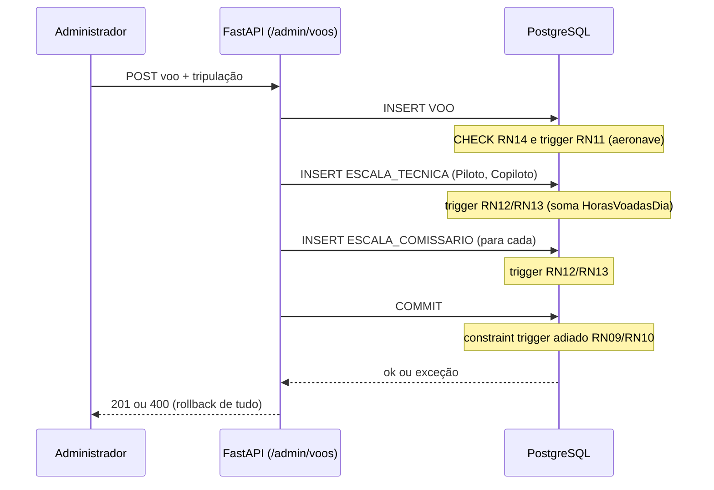

# Decolaê: explicação completa do projeto

> Este documento explica **como o projeto funciona por dentro**: o enunciado, a modelagem, cada script SQL, cada módulo do backend, os fluxos principais, o controle de concorrência e os pontos de atenção. Para instalar e executar rapidamente, consulte também o [README.md](README.md).

---

## Sumário

1. [Contexto e objetivo](#1-contexto-e-objetivo)
2. [Visão geral da arquitetura](#2-visão-geral-da-arquitetura)
3. [Estrutura de diretórios](#3-estrutura-de-diretórios)
4. [Modelagem do banco de dados](#4-modelagem-do-banco-de-dados)
5. [Scripts SQL, um por um](#5-scripts-sql-um-por-um)
6. [Regras de negócio (RN01–RN17)](#6-regras-de-negócio-rn01rn17)
7. [Backend (FastAPI)](#7-backend-fastapi)
8. [Fluxos principais](#8-fluxos-principais)
9. [Controle de concorrência](#9-controle-de-concorrência)
10. [Dados de teste (povoamento)](#10-dados-de-teste-povoamento)
11. [Protótipo de interface](#11-protótipo-de-interface)
12. [Como executar](#12-como-executar)
13. [Pontos de atenção e melhorias possíveis](#13-pontos-de-atenção-e-melhorias-possíveis)

---

## 1. Contexto e objetivo

Trabalho Prático (Opção 1) da disciplina de **Banco de Dados** do DCOMP/UFSJ (2º semestre de 2026, Prof. Leonardo Chaves Dutra da Rocha). O enunciado está em [docs/tp1.pdf](docs/tp1.pdf).

A **Decolaê** é uma companhia aérea fictícia de **voos domésticos**. O sistema gerencia trajetos, aeronaves, tripulações, voos e venda de passagens. Há três perfis de usuário:

| Perfil | Responsabilidades |
|---|---|
| **Gerente** | Cadastra, altera e remove **aeronaves**, **trajetos** e **tripulantes** (piloto, copiloto, comissários). |
| **Administrador** | Cria e gerencia **voos**, associando trajeto, aeronave e tripulação. O sistema deve impedir conflitos de horário e respeitar a escala da tripulação (no máximo 12h de jornada, depois 36h de descanso). |
| **Cliente** | Consulta voos disponíveis, escolhe assento e **compra passagens**. O sistema não pode vender acima da capacidade da aeronave. O controle de concorrência vale pontos extras. |

Entregas: **Parte 1** (modelagem), **Parte 2** (banco povoado + protótipo de interface) e **Parte 3** (aplicação final + documentação). Este repositório contém as três.

**Integrantes:** Alexandre Vital Demolinari Pereira, Julia Neves Nogueira Castro, Rafael Shiavom Gonçalves Rodrigues e Vinícius de Paiva Leles.

---

## 2. Visão geral da arquitetura



**Decisão de projeto central:** as regras de negócio ficam **dentro do banco** (constraints, triggers, constraint triggers, views e uma função transacional). O backend é uma camada **fina**: valida o formato da entrada (Pydantic), executa SQL parametrizado e converte os erros do PostgreSQL em respostas HTTP. Assim as regras valem para qualquer cliente que acesse o banco, não só para a API.

---

## 3. Estrutura de diretórios

```
Trabalho-BD/
├── README.md                     # Guia rápido de instalação/uso
├── PROJETO.md                    # Este documento
├── .gitignore                    # Ignora venv/, .env, __pycache__/, *.pyc
├── database/
│   ├── 01_ddl_criacao.sql        # Criação das 17 tabelas
│   ├── 02_dml_povoamento.sql     # Dados de teste
│   ├── 03_triggers_regras.sql    # Triggers: capacidade, conflitos, escala, disjunção
│   └── 04_views_e_funcoes.sql    # Constraint trigger, disjunção de tripulante, views, função de compra
├── backend/
│   ├── requirements.txt          # fastapi, uvicorn, psycopg2-binary, python-dotenv, pydantic[email]
│   ├── .env                      # Credenciais do banco (não versionado)
│   ├── test_concorrencia.py      # Testes de concorrência RN07/RN08
│   └── app/
│       ├── main.py               # Instancia o FastAPI, CORS, registra routers, /health
│       ├── database.py           # Conexão + tradução de erros do Postgres → HTTP
│       └── routers/
│           ├── auth.py           # /auth: login e cadastro de cliente
│           ├── cliente.py        # /cliente: voos, assentos, tipos, compra, histórico
│           ├── gerente.py        # /gerente: CRUD de aeronaves, trajetos e tripulantes
│           └── admin.py          # /admin: criação/listagem de voos, troca de status
└── docs/
    ├── tp1.pdf                               # Enunciado
    ├── decolae-database/
    │   ├── README.md                         # Instruções antigas (DBeaver)
    │   └── docs/
    │       ├── DECOLAE – Documentação do Banco de Dados.pdf
    │       ├── ModeloEntidadeRelacionamentoExtendido   # Diagrama EER (draw.io/XML)
    │       └── ModeloRelacional                        # Diagrama relacional (draw.io/XML)
    └── decolae-prototipo-interface/
        ├── prototipo_decolae.html            # Protótipo navegável (Parte 2)
        └── Tela*.png                         # Capturas das telas
```

> [!NOTE]
> Os arquivos `ModeloEntidadeRelacionamentoExtendido` e `ModeloRelacional` não têm extensão, mas são diagramas **draw.io** (XML). Abra-os em [app.diagrams.net](https://app.diagrams.net).

---

## 4. Modelagem do banco de dados

### 4.1 Hierarquias de especialização (EER)

O modelo EER usa **generalização/especialização**, que no relacional foi mapeada como **uma tabela por classe**. A subclasse usa o `CPF` como PK e como FK para a superclasse, com `ON DELETE CASCADE`.



- `USUARIO → {CLIENTE, FUNCIONARIO}`: **sobreposta**. Nada impede que uma pessoa seja cliente e funcionário ao mesmo tempo.
- `FUNCIONARIO → {GERENTE, ADMINISTRADOR, TRIPULANTE}`: **disjunta**, garantida por trigger (RN17).
- `TRIPULANTE → {TRIPULANTE_TECNICO, COMISSARIO_BORDO}`: **disjunta**, também garantida por trigger.

### 4.2 Diagrama entidade-relacionamento (relacional)



### 4.3 Destaques da modelagem

| Conceito | Onde aparece |
|---|---|
| **Entidade fraca** | `CARTAO_EMBARQUE` depende de `PASSAGEM`: PK composta `(NumPassagem, NumEmbarque)` e `ON DELETE CASCADE`. |
| **Relacionamento N:N com atributo** | `ESCALA_TECNICA` (atributo `FuncaoVoo` ∈ {Piloto, Copiloto}) e `ESCALA_COMISSARIO`. |
| **Atributos derivados** | `AssentosDisponiveis` (view `vw_voos_disponiveis`) e `ValorCompra` (view `vw_compras_resumo`). Não são armazenados. |
| **Identificador com caractere especial** | A coluna `"E-mail"` precisa de aspas duplas em todo SQL. |
| **Suposição** | O cliente que compra é o próprio passageiro (não há tabela de passageiro separada). |

---

## 5. Scripts SQL, um por um

Os scripts devem ser executados **na ordem numérica**. O povoamento (02) roda **antes** dos triggers (03/04). Por isso os dados iniciais não passam pelas validações dos triggers, e o voo de exemplo pode ser inserido antes da sua tripulação sem disparar o constraint trigger.

### 5.1 `01_ddl_criacao.sql`: estrutura

Cria as 17 tabelas, com:
- **PKs** em todas as tabelas, incluindo as compostas nas associações e na entidade fraca.
- **UNIQUE**: `"E-mail"`, `NumCredencial`, `CodigoANAC`, `(NumVoo, NumeroAssento)`.
- **CHECK**: `HorarioPrevistoChegada > HorarioPrevistoPartida` (RN14) e `FuncaoVoo IN ('Piloto','Copiloto')`.
- **FKs** com `ON DELETE CASCADE` nas hierarquias e em `CARTAO_EMBARQUE → PASSAGEM`. As demais FKs são restritivas (padrão `NO ACTION`).

### 5.2 `02_dml_povoamento.sql`: dados de teste

Popula um "ecossistema mínimo" coerente. O detalhamento está na [seção 10](#10-dados-de-teste-povoamento).

### 5.3 `03_triggers_regras.sql`: regras com triggers

| Trigger | Tabela / evento | Função | Regra |
|---|---|---|---|
| `trg_validar_capacidade_voo` | `BEFORE INSERT` em `CARTAO_EMBARQUE` | `fn_validar_capacidade_voo` | **RN08**: bloqueia a linha do voo com `SELECT ... FOR UPDATE OF v`, conta os cartões já emitidos e rejeita a inserção se `ocupados >= NumAssentos`. |
| `trg_validar_conflito_aeronave` | `BEFORE INSERT OR UPDATE` em `VOO` | `fn_validar_conflito_aeronave` | **RN11**: rejeita se a mesma aeronave estiver em outro voo não cancelado com intervalo sobreposto (`novaPartida < chegada AND novaChegada > partida`). |
| `trg_escala_tecnica_regras` / `trg_escala_comissario_regras` | `BEFORE INSERT` em `ESCALA_TECNICA` / `ESCALA_COMISSARIO` | `fn_validar_escala_tripulante` (compartilhada, usa `TG_TABLE_NAME`) | **RN12**: conflito de horário em *qualquer* escala do tripulante. **RN13**: se `HorasVoadasDia > 12` e não se passaram 36h desde `FimUltimoDescanso`, rejeita. Se aceitar, **soma a duração do voo** em `HorasVoadasDia`. |
| `trg_disj_gerente` / `trg_disj_admin` / `trg_disj_tripulante` | `BEFORE INSERT` nas três subclasses | `fn_validar_disjuncao_funcionario` | **RN17**: um funcionário só pode estar em uma das três subclasses. |

### 5.4 `04_views_e_funcoes.sql`: regras adiadas, views e compra

**Constraint trigger adiado (RN09/RN10)**

```sql
CREATE CONSTRAINT TRIGGER trg_validar_composicao_minima_voo
AFTER INSERT OR UPDATE ON VOO
DEFERRABLE INITIALLY DEFERRED
FOR EACH ROW EXECUTE FUNCTION fn_validar_composicao_minima_voo();
```

Existe um problema do tipo "ovo e galinha": as escalas referenciam `VOO` por FK, então o voo precisa existir antes delas. Ao mesmo tempo, o voo não pode existir sem tripulação. A solução é **adiar a verificação para o `COMMIT`**: dentro da mesma transação, o backend insere o voo e depois as escalas, e só no commit o trigger confere se há ≥1 Piloto, ≥1 Copiloto e ≥2 Comissários. Voos com `Status = 'Cancelado'` são ignorados.

**Disjunção de tripulante:** `trg_disjuncao_tripulante_tecnico` e `trg_disjuncao_comissario_bordo` impedem que alguém seja Técnico e Comissário ao mesmo tempo.

**Views (atributos derivados)**

| View | Conteúdo |
|---|---|
| `vw_voos_disponiveis` | Voo + aeronave + trajeto + `CapacidadeTotal` + **`AssentosDisponiveis = NumAssentos − COUNT(cartões)`** (via `LEFT JOIN` + `GROUP BY`). |
| `vw_compras_resumo` | Compra + nome do cliente + **`ValorCompra = SUM(ValorPago)`** (RN16) + `QtdPassagens`. |

**Função transacional `fn_realizar_compra(...)`**

Executa a compra inteira em uma única instrução (e, portanto, em uma única transação):

1. Busca o `ValorBase` do voo e o `Multiplicador` do tipo de passagem. Se um deles não existir, gera erro.
2. Calcula `ValorPago = ROUND(ValorBase × Multiplicador, 2)` (**RN15**).
3. `INSERT` em `COMPRA` (status `Confirmada`) → `PASSAGEM` (status `Emitida`) → `CARTAO_EMBARQUE` (status `Emitido`).
4. O último `INSERT` dispara o trigger de capacidade (RN08) e a restrição `UNIQUE` de assento (RN07).
5. Retorna o valor pago.

Se qualquer etapa falhar, nada é gravado (atomicidade).

---

## 6. Regras de negócio (RN01–RN17)

As regras estão definidas na documentação do banco (`docs/decolae-database/docs/…pdf`). A tabela abaixo mostra onde cada uma é aplicada no código:

| Código | Regra | Implementação |
|---|---|---|
| RN01 | Voo tem exatamente 1 trajeto, 1 aeronave e 1 administrador | FKs `NOT NULL` em `VOO` |
| RN02 | Passagem pertence a 1 compra e tem 1 tipo | FKs `NOT NULL` em `PASSAGEM` |
| RN03 | Compra feita por um único cliente | FK `NOT NULL` → `CLIENTE` |
| RN04 | Cartão só existe vinculado a uma passagem | PK composta + `ON DELETE CASCADE` |
| RN05 | CPF, e-mail, credencial e código ANAC são únicos | `PRIMARY KEY` / `UNIQUE` |
| RN06 | Gerente cadastra aeronave/trajeto/tripulante; administrador cria voo | FKs para `GERENTE` / `ADMINISTRADOR` |
| RN07 | Assento não se repete no mesmo voo | `UNIQUE (NumVoo, NumeroAssento)` |
| RN08 | Cartões emitidos ≤ capacidade da aeronave | Trigger + `SELECT ... FOR UPDATE` |
| RN09 | ≥ 1 piloto e ≥ 1 copiloto por voo | `CHECK` em `FuncaoVoo` + constraint trigger adiado |
| RN10 | ≥ 2 comissários por voo | Constraint trigger adiado |
| RN11 | Aeronave sem voos sobrepostos | Trigger em `VOO` |
| RN12 | Tripulante sem voos sobrepostos | Trigger nas escalas |
| RN13 | Após > 12h de jornada, 36h de descanso | Trigger nas escalas (`HorasVoadasDia`, `FimUltimoDescanso`) |
| RN14 | Chegada posterior à partida | `CHECK` em `VOO` |
| RN15 | Valor da passagem = ValorBase × Multiplicador | `fn_realizar_compra` |
| RN16 | Valor da compra = soma das passagens | `vw_compras_resumo` |
| RN17 | Funcionário em apenas uma subclasse | Triggers de disjunção |

---

## 7. Backend (FastAPI)

### 7.1 `app/main.py`

- Cria a aplicação `FastAPI` (título "Decolaê API", versão 1.0.0).
- Habilita **CORS** para qualquer origem (`*`), para que um front-end local consiga consumir a API.
- Registra os quatro routers e expõe `GET /health`.

### 7.2 `app/database.py`: conexão e tradução de erros

- `get_connection()` lê `DB_HOST`, `DB_PORT`, `DB_NAME`, `DB_USER` e `DB_PASSWORD` do `.env` (via `python-dotenv`) e usa `RealDictCursor`, então cada linha vira um `dict`.

> [!IMPORTANT]
> O PostgreSQL converte para minúsculas os identificadores sem aspas. Por isso as chaves dos dicionários retornados são minúsculas (`numvoo`, `numassentos`, ...), e o código as acessa assim.

- `get_db()` é um *context manager* que abre a conexão, entrega o cursor, faz **`commit`** ao sair do bloco ou **`rollback`** em caso de erro, e converte exceções:

| Exceção do psycopg2 | HTTP | Observação |
|---|---|---|
| `UniqueViolation` | **409** | "Registro duplicado" (ex.: assento já ocupado, CPF repetido) |
| `ForeignKeyViolation`, `CheckViolation`, `RaiseException` | **400** | Devolve a mensagem do próprio trigger (ex.: `RN11: A aeronave ...`) |
| Qualquer outra | 500 | Relançada |

Como o constraint trigger adiado só dispara no `conn.commit()`, que acontece **dentro** do `try`, os erros de RN09/RN10 também são capturados e viram 400.

Cada requisição usa **uma conexão e uma transação**. Não há pool de conexões.

### 7.3 Endpoints

#### Autenticação: `routers/auth.py` (`/auth`)

| Método | Rota | Corpo | Comportamento |
|---|---|---|---|
| POST | `/auth/login` | `{"identificador": "..."}` | Busca o usuário por **CPF, e-mail ou nº de credencial** (sem diferenciar maiúsculas/minúsculas). Faz `LEFT JOIN` com todas as subclasses e devolve a lista `papeis` (`gerente`, `administrador`, `tripulante`, `cliente`). Retorna 404 se não encontrar. |
| POST | `/auth/register` | `cpf, nome, email, telefone?, data_de_nascimento` | Insere em `USUARIO` e `CLIENTE` na mesma transação. Retorna 201. |

#### Cliente: `routers/cliente.py` (`/cliente`)

| Método | Rota | Comportamento |
|---|---|---|
| GET | `/cliente/voos?origem=&destino=&data_voo=` | Consulta `vw_voos_disponiveis` filtrando `AssentosDisponiveis > 0` e status diferente de `Cancelado`. Origem e destino usam `ILIKE` tanto na cidade quanto no aeroporto. Ordena pela partida. |
| GET | `/cliente/voos/{num_voo}/assentos` | Retorna a capacidade e a lista de assentos já ocupados (para montar o mapa de assentos). |
| GET | `/cliente/tipos-passagem` | Lista os tipos e multiplicadores. |
| POST | `/cliente/compras` | Gera um sufixo aleatório (`uuid4`, 6 caracteres hex), monta `RES-`, `PAS-` e `EMB-` e chama `fn_realizar_compra`. Retorna os códigos e o `valor_pago`. |
| GET | `/cliente/{cpf}/compras` | Histórico completo: compra + passagem + tipo + cartão + voo + trajeto. |

Exemplo de compra:

```json
POST /cliente/compras
{
  "cpf_cliente": "22222222222",
  "forma_pagamento": "PIX",
  "num_voo": "VOO-1001",
  "nome_tipo": "Executiva",
  "numero_assento": "3C"
}
```

Resposta (201): `valor_pago = 450.00 × 2.50 = 1125.00`.

#### Gerente: `routers/gerente.py` (`/gerente`)

CRUD completo de três recursos:

| Recurso | GET / POST | PUT / DELETE |
|---|---|---|
| Aeronaves | `/gerente/aeronaves` | `/gerente/aeronaves/{id_aeronave}` (PUT altera modelo e nº de assentos) |
| Trajetos | `/gerente/trajetos` | `/gerente/trajetos/{num_trajeto}` (PUT altera cidades e aeroportos) |
| Tripulantes | `/gerente/tripulantes` | `/gerente/tripulantes/{cpf}` |

Detalhes sobre tripulantes:
- **POST** insere em cascata, na mesma transação: `USUARIO` → `FUNCIONARIO` → `TRIPULANTE` (`HorasVoadasDia = 0`) → `TRIPULANTE_TECNICO` (exige `codigo_anac`) **ou** `COMISSARIO_BORDO`, conforme `tipo` (`"tecnico"` | `"comissario"`).
- **GET** devolve cada tripulante com `tipo` calculado por `CASE`.
- **PUT** atualiza `USUARIO`, `FUNCIONARIO` e, se `codigo_anac` for enviado, `TRIPULANTE_TECNICO`.
- **DELETE** remove de `USUARIO`, e o `ON DELETE CASCADE` limpa as subclasses.

#### Administrador: `routers/admin.py` (`/admin`)

| Método | Rota | Comportamento |
|---|---|---|
| GET | `/admin/voos` | Todos os voos (incluindo cancelados e lotados), com as listas `escala_tecnica` e `escala_comissarios` anexadas. |
| POST | `/admin/voos` | Na **mesma transação**: insere o `VOO` (RN11, RN14), a escala técnica (Piloto + Copiloto; RN12, RN13), cada comissário de `cpfs_comissarios` (RN12, RN13) e, no **commit**, o constraint trigger valida RN09/RN10. |
| PATCH | `/admin/voos/{num_voo}/status` | Altera o status para `Programado`, `Atrasado`, `Cancelado` ou `Concluído`. |

Exemplo de criação de voo:

```json
POST /admin/voos
{
  "num_voo": "VOO-2002",
  "data_voo": "2026-12-01",
  "status": "Programado",
  "horario_previsto_partida": "2026-12-01T08:00:00",
  "horario_previsto_chegada": "2026-12-01T09:15:00",
  "valor_base": 380.00,
  "cpf_administrador": "44444444444",
  "num_aeronave": "PR-XYZ",
  "num_trajeto": "TRJ-CNF-GRU",
  "cpf_piloto": "55555555555",
  "cpf_copiloto": "66666666666",
  "cpfs_comissarios": ["77777777777", "88888888888"]
}
```

---

## 8. Fluxos principais

### 8.1 Compra de passagem



### 8.2 Criação de voo



---

## 9. Controle de concorrência

O enunciado oferece pontos extras para controle de concorrência. O projeto trata os dois cenários clássicos:

**RN07: dois clientes, mesmo assento, ao mesmo tempo.**
A restrição `UNIQUE (NumVoo, NumeroAssento)` é a garantia final. Como as duas transações também disputam o lock `FOR UPDATE` da linha do voo (dentro do trigger), elas são serializadas: a primeira faz commit e a segunda recebe `UniqueViolation`, que vira **409**.

**RN08: "último assento" disputado por várias compras de assentos diferentes.**
O `UNIQUE` não resolve esse caso, porque os assentos são distintos. Sem lock, no nível `READ COMMITTED` padrão, duas transações poderiam contar `ocupados = capacidade − 1` ao mesmo tempo e ambas inserir (*lost update* / *write skew*). O trigger evita isso com:

```sql
SELECT a.NumAssentos INTO v_capacidade
FROM VOO v JOIN AERONAVE a ON v.NumAeronave = a.ID_Aeronave
WHERE v.NumVoo = NEW.NumVoo
FOR UPDATE OF v;   -- bloqueia só a linha do VOO até o fim da transação
```

As transações do mesmo voo passam a ser executadas uma de cada vez **naquele trecho**. A segunda só faz a contagem depois que a primeira termina, e então vê o cartão já inserido. Compras em **voos diferentes** não se bloqueiam.

**Script de teste:** [backend/test_concorrencia.py](backend/test_concorrencia.py), com a API rodando.
1. `teste_rn07_mesmo_assento`: duas threads compram o assento `15A` do `VOO-1001`. Esperado: uma resposta **201** e uma **409**.
2. `teste_rn08_capacidade_maxima`: cria a aeronave `PR-LOCK1` (1 assento) e o voo `VOO-LOCK1`, depois dispara 5 compras simultâneas (`1A`..`1E`). Esperado: **1** compra confirmada e 4 respostas **400** (`RN08: ... capacidade máxima`).

> [!NOTE]
> O script usa apenas a biblioteca padrão (`urllib`, `concurrent.futures`) e por isso não precisa de dependências extras. Os passos de preparação ignoram erros, então ele pode ser executado mais de uma vez. Porém, depois da primeira execução os assentos já estarão ocupados e todas as compras falharão.

---

## 10. Dados de teste (povoamento)

| CPF | Nome | Papel | Credencial / extra |
|---|---|---|---|
| 11111111111 | João Silva | Cliente | `joao.cliente@email.com` |
| 22222222222 | Maria Santos | Cliente | `maria.cliente@email.com` |
| 33333333333 | Carlos Gerente | Gerente | `CRED-GER-001` |
| 44444444444 | Ana Admin | Administrador | `CRED-ADM-001` |
| 55555555555 | Pedro Piloto | Tripulante técnico | `CRED-TEC-001`, `ANAC-12345` |
| 66666666666 | Paulo Copiloto | Tripulante técnico | `CRED-TEC-002`, `ANAC-67890` |
| 77777777777 | Sara Comissária | Comissária de bordo | `CRED-COM-001` |
| 88888888888 | Marta Comissária | Comissária de bordo | `CRED-COM-002` |

Infraestrutura e operação:
- **Aeronave** `PR-XYZ`: Boeing 737-800, 180 assentos.
- **Trajeto** `TRJ-CNF-GRU`: Confins (Belo Horizonte, MG) → Guarulhos (São Paulo, SP).
- **Voo** `VOO-1001`: 15/11/2026, 10:00 → 11:20, valor base R$ 450,00, status *Programado*, com piloto, copiloto e 2 comissárias.
- **Tipos de passagem:** Econômica (×1,00) e Executiva (×2,50).
- **Compra** `RES-A1B2C3` (João) → passagem `PAS-999123` (R$ 450,00) → cartão `EMB-001`, assento `12A`.

Exemplos de login: `{"identificador": "CRED-GER-001"}` (gerente), `{"identificador": "ana.adm@decolae.com"}` (administradora), `{"identificador": "11111111111"}` (cliente).

---

## 11. Protótipo de interface

Feito na Parte 2: [docs/decolae-prototipo-interface/prototipo_decolae.html](docs/decolae-prototipo-interface/prototipo_decolae.html). É uma página HTML estática e navegável que simula as telas do sistema (os dados são fixos, não há integração com a API):

| Tela | Perfil | Imagem |
|---|---|---|
| Busca de voos | Cliente | `TelaVoos.png` |
| Mapa de assentos | Cliente | `TelaAssentos.png` |
| Minhas compras | Cliente | `TelaMInhasCompras.png` |
| Cadastros | Gerente | `TelaGerente.png` |
| Gestão de voos | Administrador | `TelaAdmin.png` |

Os endpoints da API foram desenhados para alimentar exatamente essas telas. Por exemplo, `/cliente/voos/{num_voo}/assentos` devolve capacidade + ocupados, que é o necessário para desenhar o mapa de assentos.

---

## 12. Como executar

```bash
# 1. Banco
createdb -U postgres decolae
for f in database/0{1,2,3,4}_*.sql; do psql -U postgres -d decolae -f "$f"; done

# 2. Backend
cd backend
python -m venv venv && source venv/bin/activate
pip install -r requirements.txt
cat > .env <<EOF
DB_HOST=localhost
DB_PORT=5432
DB_NAME=decolae
DB_USER=postgres
DB_PASSWORD=postgres
EOF
uvicorn app.main:app --reload      # Swagger em http://127.0.0.1:8000/docs

# 3. Testes de concorrência (em outro terminal, com a API no ar)
python test_concorrencia.py
```

---

## 13. Pontos de atenção e melhorias possíveis

Encontrei os itens abaixo ao ler o código.

> [!NOTE]
> **Bugs já corrigidos (22/11/2026)**
> 1. **[01_ddl_criacao.sql, linha 7](database/01_ddl_criacao.sql#L7)**: sobrava uma vírgula depois de `DataDeNascimento date not null`, antes do `);`. Isso gerava erro de sintaxe e a tabela `USUARIO`, da qual todas as outras dependem, não era criada. A vírgula foi removida. Os 4 scripts rodaram sem erro num PostgreSQL 18 limpo (17 tabelas criadas).
> 2. **[admin.py, linha 113](backend/app/routers/admin.py#L113)**: estava escrito `atualizado - cur.fetchone()` (subtração) no lugar de `atualizado = cur.fetchone()`, e a rota `PATCH /admin/voos/{num_voo}/status` sempre retornava **500**. A atribuição foi corrigida. O `UPDATE` que a rota executa foi testado direto no banco; a rota ainda não foi testada pela API.

**Limitações de regra de negócio**
- **RN13 é parcial:** `HorasVoadasDia` só cresce. Nada a zera e nada atualiza `FimUltimoDescanso`. A verificação acontece **antes** de somar o voo atual, então um voo que leva a jornada de 10h para 14h é aceito; o bloqueio só ocorre no voo seguinte.
- O trigger de escala só dispara em `INSERT`. Mudar os horários de um voo já escalado (`UPDATE VOO`) não revalida os conflitos dos tripulantes.
- Ao reduzir `NumAssentos` de uma aeronave (`PUT /gerente/aeronaves`), o sistema não verifica se já existem mais cartões emitidos do que a nova capacidade.
- `NumeroAssento` é texto livre: não há validação de que o assento (ex.: `99Z`) existe na aeronave.
- Remover aeronave, trajeto ou tripulante já usados em voos resulta em **400** (violação de FK), o que é o comportamento esperado. Porém não existe exclusão lógica nem cancelamento de compra.

**Segurança / arquitetura**
- **Não há autenticação real:** o login aceita só um identificador, sem senha, e não emite token. As rotas `/gerente` e `/admin` não verificam o papel de quem chama, e o `cpf_gerente`/`cpf_administrador` vem no corpo da requisição. A FK garante apenas que o CPF pertence a um gerente/administrador (RN06), não que é quem está logado.
- O CORS está aberto para `*`, o que é aceitável em ambiente acadêmico.
- Cada requisição abre uma conexão nova. Um pool (`psycopg2.pool`) melhoraria o desempenho.
- O código de reserva usa 6 caracteres hex aleatórios (~16 milhões de combinações). Uma colisão resultaria em 409.
- `GET /admin/voos` faz 2 consultas extras por voo (problema N+1).
- O [README do banco](docs/decolae-database/README.md) ainda cita a pasta antiga `scripts/`, que hoje se chama `database/`.
