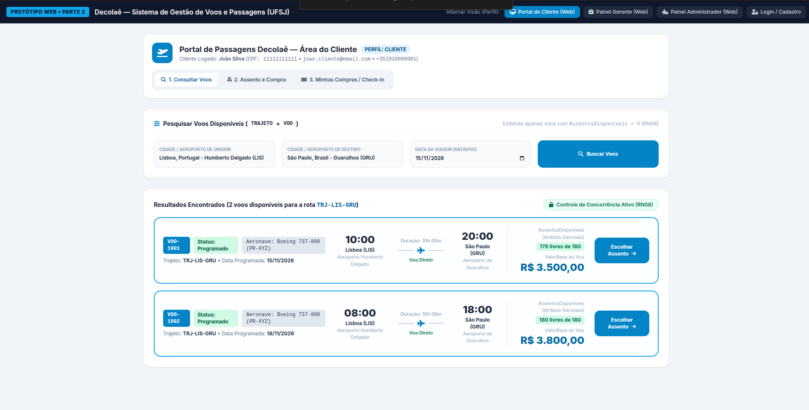
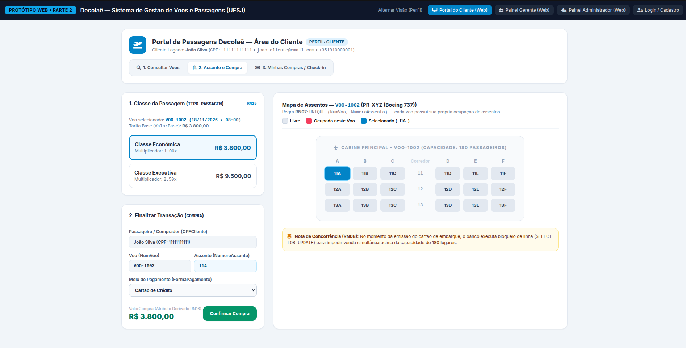
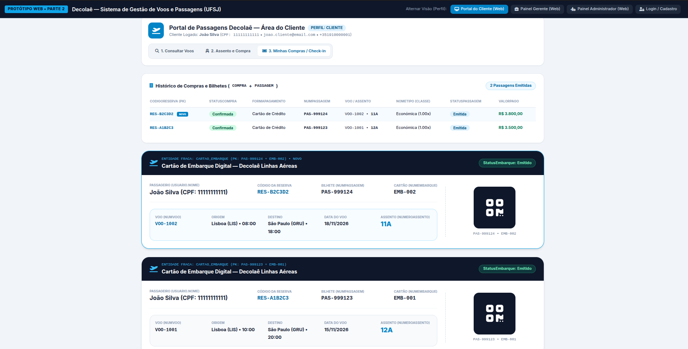
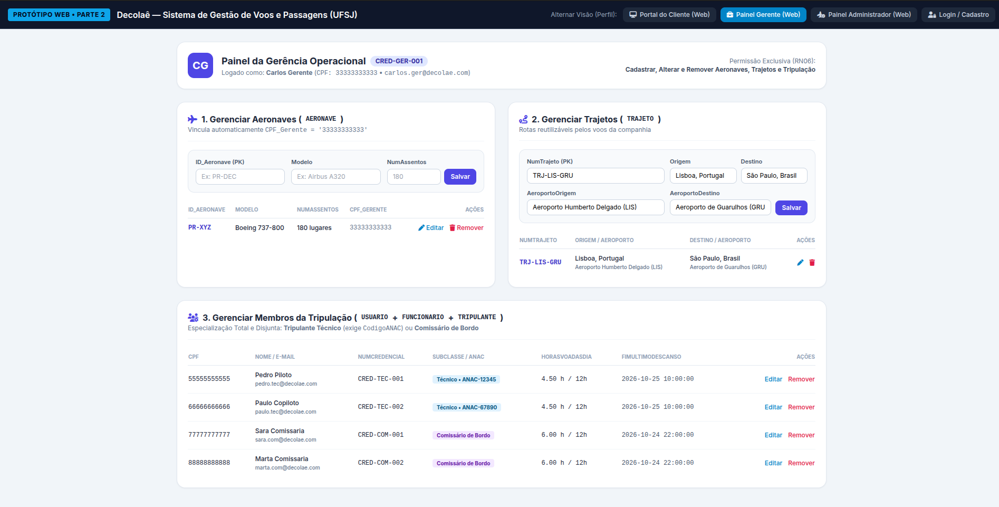
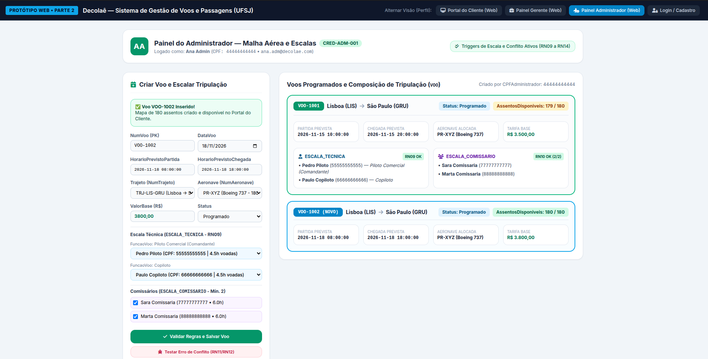

# Decolaê – Sistema de Gestão de Voos e Passagens

Trabalho Prático da disciplina de **Banco de Dados**. O **Decolaê** é um sistema de companhia aérea para gerenciar aeronaves, trajetos, voos, tripulação e a venda de passagens. O sistema usa um banco **PostgreSQL**, um backend em **FastAPI** e um front-end em **React**.

## Integrantes

- Alexandre Vital Demolinari Pereira
- Julia Neves Nogueira Castro
- Rafael Shiavom Gonçalves Rodrigues
- Vinícius de Paiva Leles

## Estrutura do Projeto

```
Trabalho-BD/
├── backend/
│   ├── app/
│   │   ├── main.py               # Ponto de entrada da API (FastAPI)
│   │   ├── database.py           # Conexão com o PostgreSQL e tratamento de erros
│   │   └── routers/
│   │       ├── auth.py           # Login e cadastro de clientes
│   │       ├── cliente.py        # Consulta de voos, assentos e compras
│   │       ├── gerente.py        # CRUD de aeronaves, trajetos e tripulantes
│   │       └── admin.py          # Gestão de voos
│   ├── test_concorrencia.py      # Testes de concorrência (RN07 e RN08)
│   └── requirements.txt
├── database/
│   ├── 01_ddl_criacao.sql        # Criação das tabelas
│   ├── 02_dml_povoamento.sql     # Dados de teste
│   ├── 03_triggers_regras.sql    # Triggers das regras de negócio
│   └── 04_views_e_funcoes.sql    # Views, constraint triggers e função de compra
├── frontend/                     # Telas em React + Vite + Tailwind (ver frontend/README.md)
└── docs/
    ├── tp1.pdf                   # Enunciado do trabalho
    ├── decolae-database/         # Modelos EER, relacional e documentação do BD
    └── decolae-prototipo-interface/  # Protótipo de interface (HTML + telas)
```

## Banco de Dados

### Modelo

O esquema tem as seguintes entidades principais:

| Grupo | Tabelas |
|---|---|
| Usuários | `USUARIO`, `CLIENTE`, `FUNCIONARIO`, `GERENTE`, `ADMINISTRADOR` |
| Tripulação | `TRIPULANTE`, `TRIPULANTE_TECNICO`, `COMISSARIO_BORDO`, `ESCALA_TECNICA`, `ESCALA_COMISSARIO` |
| Operação | `AERONAVE`, `TRAJETO`, `VOO` |
| Vendas | `COMPRA`, `PASSAGEM`, `TIPO_PASSAGEM`, `CARTAO_EMBARQUE` |

Os diagramas e a documentação completa estão em [`docs/decolae-database/docs`](docs/decolae-database/docs).

### Regras de negócio implementadas no banco

- **Capacidade da aeronave:** impede vender mais assentos que a capacidade, com controle de concorrência via `SELECT ... FOR UPDATE`.
- **Conflito de aeronave:** a mesma aeronave não pode estar em voos com horários sobrepostos.
- **Escala de tripulantes:** impede conflitos de horário e exige o tempo mínimo de descanso.
- **Composição mínima da tripulação:** validada por um *constraint trigger* adiado (`DEFERRABLE`).
- **Especialização disjunta:** um funcionário só pode ser Gerente, Administrador **ou** Tripulante. Um tripulante só pode ser Técnico **ou** Comissário.
- **Assento único por voo:** garantido por restrição `UNIQUE` em `CARTAO_EMBARQUE`.

### Views e funções

- `vw_voos_disponiveis`: voos com o atributo derivado **AssentosDisponiveis**.
- `vw_compras_resumo`: compras com o atributo derivado **ValorCompra**.
- `fn_realizar_compra(...)`: faz a compra em uma única transação (`COMPRA` → `PASSAGEM` → `CARTAO_EMBARQUE`). O valor é `ValorBase × Multiplicador` do tipo de passagem.

### Criação do banco

Crie um banco chamado `decolae` e execute os scripts **nesta ordem**:

```bash
createdb -U postgres decolae
psql -U postgres -d decolae -f database/01_ddl_criacao.sql
psql -U postgres -d decolae -f database/02_dml_povoamento.sql
psql -U postgres -d decolae -f database/03_triggers_regras.sql
psql -U postgres -d decolae -f database/04_views_e_funcoes.sql
```

> Também é possível executar os scripts por uma ferramenta gráfica, como o **DBeaver**.

## Backend (API)

### Requisitos

- Python 3.10+
- PostgreSQL com o banco já criado

### Instalação

```bash
cd backend
python -m venv venv
source venv/bin/activate        # Windows: venv\Scripts\activate
pip install -r requirements.txt
```

Crie o arquivo `backend/.env` com as credenciais do banco:

```env
DB_HOST=localhost
DB_PORT=5432
DB_NAME=decolae
DB_USER=postgres
DB_PASSWORD=postgres
```

### Execução

```bash
cd backend
uvicorn app.main:app --reload
```

A API fica disponível em `http://127.0.0.1:8000`. A documentação interativa (Swagger) fica em **`http://127.0.0.1:8000/docs`**.

### Endpoints

| Módulo | Método | Rota | Descrição |
|---|---|---|---|
| Sistema | GET | `/health` | Verifica se a API está no ar |
| Autenticação | POST | `/auth/login` | Login por CPF, e-mail ou nº de credencial |
| | POST | `/auth/register` | Cadastro de cliente |
| Cliente | GET | `/cliente/voos` | Lista os voos disponíveis |
| | GET | `/cliente/voos/{num_voo}/assentos` | Assentos de um voo |
| | GET | `/cliente/tipos-passagem` | Tipos de passagem |
| | POST | `/cliente/compras` | Faz uma compra |
| | GET | `/cliente/{cpf}/compras` | Histórico de compras |
| Gerente | GET/POST | `/gerente/aeronaves` | Lista ou cadastra aeronaves |
| | PUT/DELETE | `/gerente/aeronaves/{id_aeronave}` | Edita ou remove uma aeronave |
| | GET/POST | `/gerente/trajetos` | Lista ou cadastra trajetos |
| | PUT/DELETE | `/gerente/trajetos/{num_trajeto}` | Edita ou remove um trajeto |
| | GET/POST | `/gerente/tripulantes` | Lista ou cadastra tripulantes |
| | PUT/DELETE | `/gerente/tripulantes/{cpf}` | Edita ou remove um tripulante |
| Administrador | GET/POST | `/admin/voos` | Lista ou cadastra voos |
| | PATCH | `/admin/voos/{num_voo}/status` | Atualiza o status de um voo |

Os erros vindos do banco viram respostas HTTP:
- Violação de unicidade → **409**.
- Violação de chave estrangeira, de `CHECK` ou exceção de trigger → **400**, com a mensagem do próprio trigger.

## Front-end

### Requisitos

- Node.js 18+
- API rodando (seção anterior)

### Execução

Em outro terminal, com a API no ar:

```bash
cd frontend
npm install        # só na primeira vez
npm run dev
```

Abra **`http://localhost:5173`**. Na tela de login há botões de acesso rápido com os usuários do povoamento:

| Perfil | Usuário | CPF |
|---|---|---|
| Cliente | João Silva | `11111111111` |
| Gerente | Carlos Gerente | `33333333333` |
| Administrador | Ana Admin | `44444444444` |

Também dá para entrar digitando CPF, e-mail ou nº de credencial. Se a API estiver em outro endereço, copie `frontend/.env.example` para `frontend/.env` e ajuste `VITE_API_URL`.

As telas e a organização do código estão descritas em [`frontend/README.md`](frontend/README.md).

## Testes de Concorrência

O script [`backend/test_concorrencia.py`](backend/test_concorrencia.py) faz requisições simultâneas para validar:

- **RN07:** dois clientes tentam comprar o mesmo assento ao mesmo tempo. Só uma compra deve ser aceita.
- **RN08:** cinco compras simultâneas em uma aeronave de 1 assento. A capacidade é respeitada graças ao `SELECT FOR UPDATE`.

Com a API em execução:

```bash
cd backend
python test_concorrencia.py
```

## Protótipo de Interface

O protótipo está em [`docs/decolae-prototipo-interface`](docs/decolae-prototipo-interface). Abra o arquivo `prototipo_decolae.html` no navegador.

| Voos | Assentos | Minhas Compras |
|---|---|---|
|  |  |  |

| Gerente | Administrador |
|---|---|
|  |  |

## Tecnologias

- **PostgreSQL**: banco de dados relacional (PL/pgSQL para triggers e funções)
- **Python + FastAPI**: API REST
- **psycopg2**: driver do PostgreSQL
- **Pydantic**: validação dos dados de entrada
- **Uvicorn**: servidor ASGI
- **React + Vite + Tailwind**: front-end
